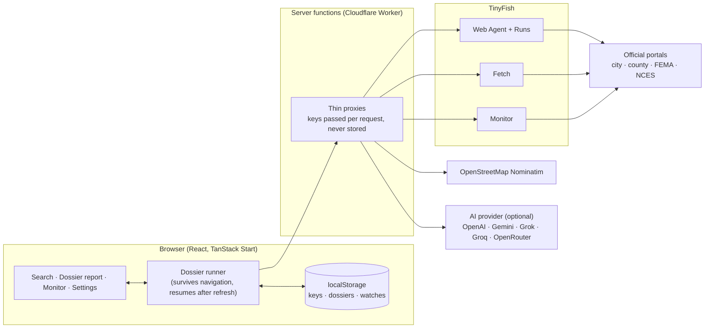
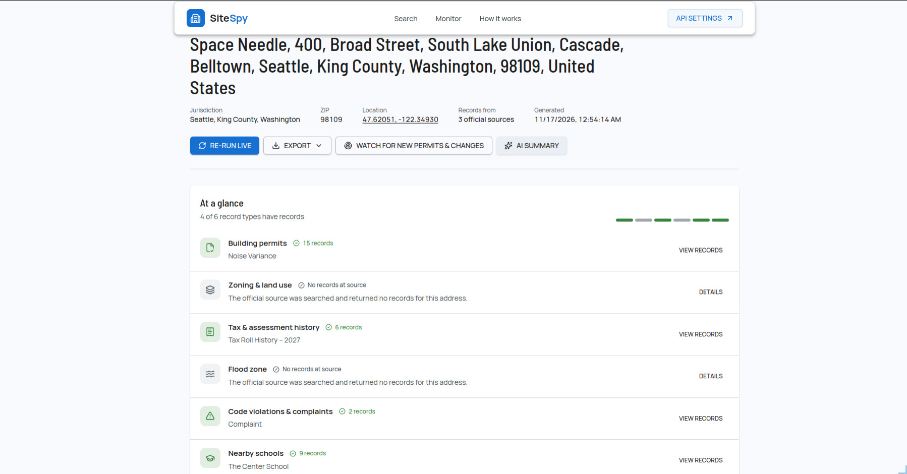
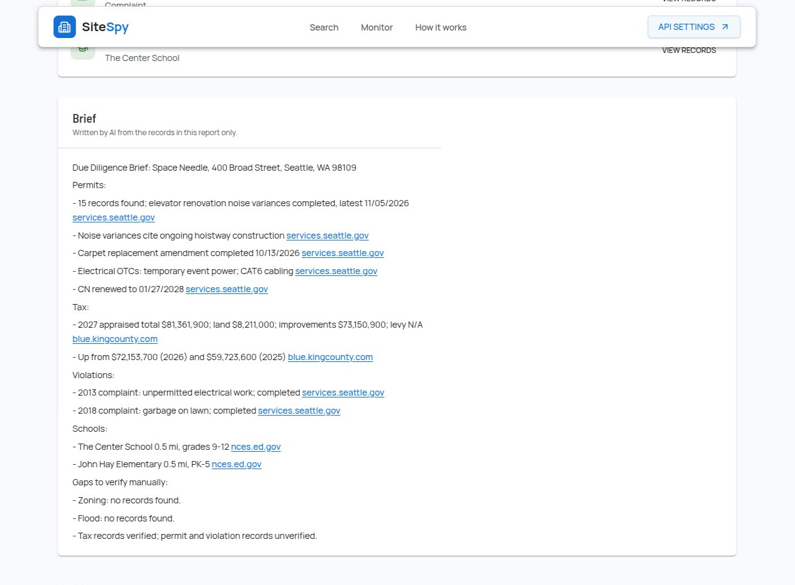
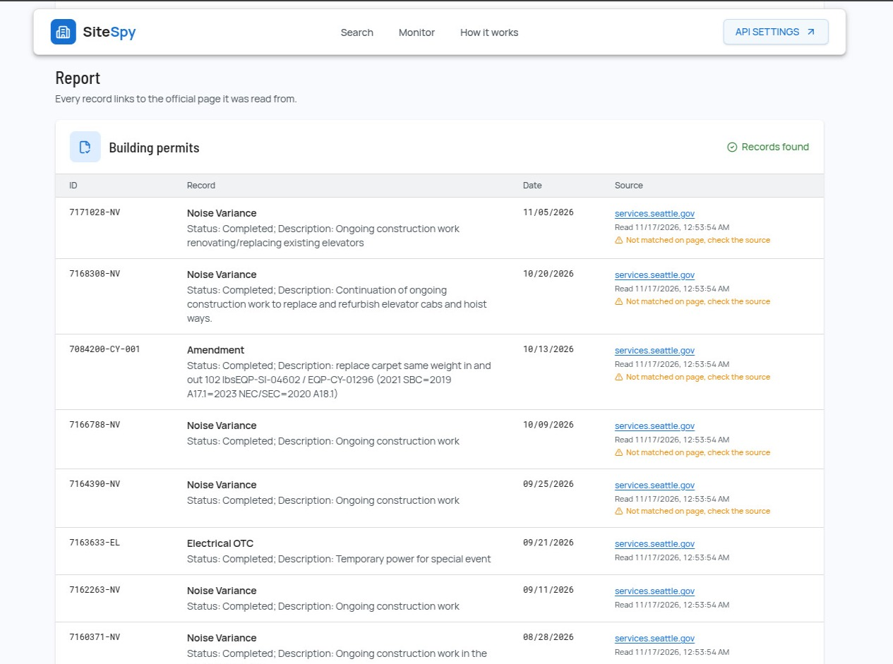

<div align="center">
  

  <h1>SiteSpy</h1>

  <p><strong>Property dossiers from official records.</strong><br/>
  Permits, zoning, tax history, flood zone, violations and nearby schools for one address, with every record linked to the government page it came from.</p>

  <p>
    
    
    
    
    
    <br/>
    
    
    
    
  </p>
</div>

---

## Project summary

Before anyone buys, builds on or renovates a property, someone digs through city and county websites by hand. Most of those sites have no API: you type the address into a search form, open the right tab, filter a list and copy what you find.

SiteSpy does that digging with TinyFish. Enter an address (or a parcel number) in **Seattle / King County, San Francisco or New York City** and it returns a property dossier pulled live from official sources:

| Record type | Example sources |
| --- | --- |
| Building permits | Seattle SDCI, SF Department of Building Inspection, NYC DOB (BIS and DOB NOW) |
| Zoning & land use | Seattle SDCI, SF Property Information Map, NYC Planning ZoLa |
| Tax & assessment history | King County Assessor, SF Assessor and Treasurer, NYC Department of Finance |
| Flood zone | FEMA Flood Map Service Center and National Flood Hazard Layer |
| Code violations & complaints | Seattle SDCI and Services Portal, SF DBI, NYC DOB and HPD |
| Nearby schools | NCES public school search |

The output is a readable report, exportable as **JSON** or **PDF**. Every record links to its source page. Anything that couldn't be found is flagged as *No records at source* or *Source unavailable* with the reason, never guessed. An optional AI brief summarises only the records already found. **Watch** keeps monitoring the address for new permits and changes.

There is no backend database and no sign-in. You bring your own TinyFish key (and optionally an AI provider key). Keys stay in your browser and are sent per request through thin server proxies.

## How TinyFish is used

| TinyFish API | Endpoint | How SiteSpy uses it |
| --- | --- | --- |
| **Web Agent** | `POST agent.tinyfish.ai/v1/automation/run-async` | The core retrieval. One run per record type opens the official portal in a stealth browser with a US proxy. It follows numbered navigation steps written for that site (type the address into the search form, pick the property, open the tab, filter, page through) and returns records in a fixed `output_schema`: id, title, date, details copied verbatim, and the exact source URL. |
| **Runs** | `GET agent.tinyfish.ai/v1/runs/{id}`, `POST …/runs/{id}/cancel` | The browser polls each run every 5 s. It shows whether the run is queued or running, the agent's latest step (e.g. "Filter record type to Building & Construction") and its `streaming_url`, played in an in-page live view. Stopping a search, or a run that times out, cancels it so it stops costing credits. Saved run IDs let a refreshed page reconnect to the same runs instead of starting new ones. |
| **Fetch** | `POST api.fetch.tinyfish.ai` | After the agent extracts records, Fetch re-reads each record's source page without a browser. It checks that the record's official ID or main figure really appears there and marks matches *Matched on page*. Pages that only render in a browser are left unmarked rather than guessed. It's also used (free) by the live test suite to confirm every mapped portal responds. |
| **Monitor** | `POST/DELETE agent.tinyfish.ai/v1/monitors`, `POST …/monitors/{id}/runs` | **Watch for new permits & changes** creates a daily page monitor on the pages the records came from. **Re-check** runs them now and shows what changed on each page. It then sends the agent back to the permit and violation portals and diffs the records against the saved snapshot, listing each one added, changed or removed. |

## How it works

1. **Locate.** The address is geocoded with OpenStreetMap Nominatim (free) and matched to a supported jurisdiction. An NYC address is mapped to its borough, and parcel numbers use each city's own format: King County parcel, SF block/lot, NYC BBL. Addresses outside the supported areas are rejected here, before any TinyFish credit is spent.
2. **Retrieve.** For each record type, the agent works through that city's official portals in order of preference. A backup portal is tried only when the first is blocked or fails. A portal holding a *different* record set (e.g. NYC HPD alongside the Department of Buildings) is also checked after a "not found".
3. **Verify.** Fetch cross-checks each record on its source page.
4. **Report.** Each record type ends in an explicit state: *Records found*, *No records at source* or *Source unavailable*, with the reason. The report is the main output. JSON and PDF are exports.
5. **Watch.** Monitor tracks the record pages, and re-checks diff permits and violations.

### Why the official sources are fixed for a few supported areas

The first version found sources dynamically: TinyFish Search looked up "official building permit portal" (and so on) for the address's city, kept government domains, and sent the agent to whatever came back. Live testing showed this was the wrong trade-off:

- **Search returned the wrong jurisdiction.** For *221B Baker Street, London* it returned `westminster-ca.gov` (Westminster, California). For *San Francisco City Hall* it returned LA County, Marin County, San Mateo County and South San Francisco sites. Every one of those is a real `.gov` domain, so a domain filter can't catch it.
- **It returned the wrong level of government.** For a Seattle address, Search ranked King County's permit system first. The agent searched it correctly and reported, rightly, that King County only issues permits for *unincorporated* areas, so Seattle addresses aren't there. That's a paid agent run that could never succeed.
- **It returned information pages, not lookup tools.** Many results were "how to apply" or "contact us" pages, so agents spent minutes navigating before reaching a search form, or never found one.

Each of these wasted agent runs and credits, and could only end in a misleading "not found". So SiteSpy supports **a fixed set of areas with researched sources**. For Seattle, San Francisco and New York City, every record type has curated official portals, each with step-by-step instructions taken from that site's own help pages. The entry URLs and page labels were verified live with Fetch. For example, the NYC DOB link opens straight onto the property profile, and SF DBI's street-name format was corrected after testing.

The sources are fixed; the lookups are not. Every address in a supported city works. Each portal's URL is built from the property's own address, ZIP or parcel, and the agent reads whatever the site shows at that moment. Adding a city means adding a `Jurisdiction` in `src/lib/sources.ts` and verifying its URLs first.

## High-level architecture



- **Orchestration runs in the browser** (`src/lib/dossier-runner.ts`, `src/lib/run-dossier.ts`). Long agent runs are polled from the client instead of holding a server request open. Progress is saved after every update, so leaving the page or refreshing reconnects to the same runs. A tab lock stops duplicate runs.
- **Server functions** (`src/lib/tinyfish.functions.ts`) are thin proxies that avoid CORS. User keys arrive with each request and are never stored.
- **Pure, tested logic** (`src/lib/dossier-core.ts`): record status rules, record cleaning, the on-page cross-check, snapshot diffs, the agent's output schema, and the brief parser that only allows source links really in the dossier.
- **Jurisdiction registry** (`src/lib/sources.ts`): supported cities, their portals per record type, URL builders and agent steps.

```
src/lib/sources.ts             Supported cities, official portals, agent navigation steps
src/lib/run-dossier.ts         Per-section agent runs, fallbacks, Fetch cross-check, stop/resume
src/lib/dossier-runner.ts      Run lifecycle outside the page: persistence, resume, tab lock
src/lib/dossier-core.ts        Pure rules and parsers (unit tested)
src/lib/tinyfish.functions.ts  Server-function proxies for TinyFish, geocoding and AI
src/components/                Run board, live agent dock, report cards, AI brief
src/routes/                    Search, dossier, monitor, settings, how it works
```

## Project setup

**Requirements:** Node.js 20+ and npm, a [TinyFish](https://tinyfish.ai) API key, and optionally an OpenAI, Gemini, Grok, Groq or OpenRouter key for the AI brief.

```sh
git clone <this-repository-url> sitespy
cd sitespy
npm install
npm run dev            # http://localhost:8080
```

Open **API settings** in the app and paste your keys. They're saved only in that browser.

| Command | Purpose |
| --- | --- |
| `npm run dev` | Dev server |
| `npm run build` | Production build (Cloudflare Workers) |
| `npm run preview` | Preview the production build |
| `npx vitest run` | Unit tests |
| `LIVE=1 npx vitest run src/test/live-dossier.test.ts` | Live check that every mapped portal responds (TinyFish Fetch, free) |
| `LIVE=1 LIVE_AGENT=seattle npx vitest run src/test/live-dossier.test.ts` | One full paid dossier with the agent plus a Monitor check (`seattle` \| `san-francisco` \| `nyc`) |

The live tests read `TINYFISH_API_KEY` from the environment.

## Demo

### Output



### AI brief



### Building permits



### Code violations


### Nearby schools


